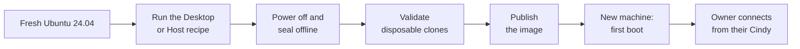

<p align="center">
  <a href="https://cindy.app"></a>
</p>

<p align="center">
  <strong>English</strong> · <a href="README.zh-CN.md">简体中文</a>
</p>

<p align="center">
  <a href="https://github.com/makecindy/cindy-cloud-images/actions/workflows/check.yml"></a>
  
  
</p>

<p align="center">
  <a href="https://github.com/makecindy/cindy">Cindy</a> &nbsp;·&nbsp; <a href="https://cindy.app">Website</a> &nbsp;·&nbsp; <a href="docs/cindy-readiness.md">Readiness checklist</a> &nbsp;·&nbsp; <a href="docs/builder-maintenance.md">Builder maintenance</a>
</p>

# Cindy Cloud Images

**Cindy's operating system environment, ready out of the box.** These are the
Ubuntu 24.04 image recipes behind Cindy cloud computers. A machine made from
them boots with [Cindy](https://github.com/makecindy/cindy) installed and
running, so its owner can hand it work from their own Cindy account right away.

| Image | What it runs | Where to customize it |
| --- | --- | --- |
| **Desktop** | Cindy with XFCE, an authenticated X11 display, Chrome by default and Firefox | [Desktop installer and first-boot settings](desktop/install-desktop.sh) |
| **Host** | Cindy Host as a systemd user service, with a per-instance credential store | [Host installer](host/prepare-host-image.py) and [keyring setup](host/host-keyring.sh) |

## What's in the box

| | Desktop image | Host image |
| --- | --- | --- |
| **Starts by itself** | XFCE starts Cindy at boot | A systemd user service enrolls the machine, then starts Cindy Host |
| **A computer Cindy can operate** | Its own X11 session with XTest input, clipboard tools, AT-SPI and a user D-Bus | Terminal and background tasks |
| **Browser** | Chrome Stable handles web links, Firefox is available | Installed by the task that needs one |
| **Files and development** | Thunar, Mousepad, a PDF viewer, an archive manager, Git, ripgrep, rsync, curl and jq | A Node runtime ships with the Host release |
| **Language and display** | Ten interface languages, CJK and emoji fonts, 1600 × 1000 or 1920 × 1080 | The Ubuntu base environment |
| **Cindy updates** | The newest official Cindy on first boot, then updates install while idle | The release baked into the image |
| **Look** | The Cindy Whisper wallpaper, dark window chrome and a bottom panel with Cindy, Chrome, Files and Terminal | — |

Every machine starts as its own. Sealing removes builder identities, SSH host
keys and cloud-init state, and refuses an image that still carries enrollment
files, keyring state or browser profiles. SSH accepts only the owner's device
keys, which Cindy on the machine maintains.

## From a clean Ubuntu to a ready machine



Both recipes assume a fresh Ubuntu image with an `ubuntu` user and systemd. Use a trusted Cindy Linux release that supports cloud enrollment and matches the architecture and service environment of the intended guests. Obtain its SHA-256 digest from the approved release record. The image repository contains build instructions and tests. The deployment service owns region-specific image IDs, billing and single-use guest enrollment.

For the shared monthly builder, renewal checks and regional image publication, see [builder maintenance](docs/builder-maintenance.md).

## Prepare a Desktop image

Run the following **on a fresh Ubuntu 24.04 build system**. Set `DESKTOP_DEB` to the installer path and `DEB_SHA256` to its approved digest. Image preparation changes SSH configuration and installs system packages. Use an out-of-band builder management channel.

```sh
sudo bash desktop/install-desktop.sh --prepare-image "$DEB_SHA256" "$DESKTOP_DEB"
```

The installer prepares XFCE, the credential store, Ubuntu desktop language packs (`en-US`, `zh-CN`, `zh-TW`, `ja-JP`, `ko-KR`, `de-DE`, `fr-FR`, `es-ES`, `pt-BR`, `pt-PT`) and the Cindy autostart entry. It installs Google Chrome Stable from Google's signed APT repository and sets the system default for web links. Firefox remains available, alongside a text editor, PDF viewer, archive manager and basic command-line tools. Shut down the builder after installation and mount its system disk on a separate Linux machine.

On each provisioned guest:

- **Activation.** The deployment bootstrap calls `/usr/local/lib/cindy-cloud-desktop/activate` with the desired language, display size and timezone, for example `en-US 1920x1080 America/Los_Angeles`, writing session defaults and `/etc/default/locale` offline.
- **Unattended updates.** Activation also turns on Cindy's install-updates-while-idle setting unless the guest user already chose otherwise; the image installs `pkexec` and a polkit rule so the desktop user's updates install without a password prompt.
- **First boot.** Each guest installs the newest official Cindy for the baked release's region before the desktop session starts Cindy, and keeps the baked release if the download or any check fails.
- **Session.** The desktop session uses the guest user's systemd session bus.

Run the installer from a checkout so it can read [the XFCE defaults and wallpaper](desktop/appearance/README.md). New desktop profiles open with Cindy Whisper, dark window chrome and a bottom panel with Cindy, Chrome, Files and Terminal. Users can customize the appearance from XFCE Settings.

## Prepare a Host image

Install `dbus-user-session`, `gnome-keyring`, `libsecret-tools`, `openssl` and `util-linux` in the clean base image. Shut down the builder and mount its system disk on a separate Linux machine. Set `IMAGE_ROOT` to that mount, `HOST_RELEASE` to the unpacked release directory, and `INVENTORY_SHA256` to the digest of its `SHA256SUMS.json`. Match the edition (`cn` or `global`) and architecture (`x64` or `arm64`) to the release.

```sh
sudo python3 host/prepare-host-image.py "$HOST_RELEASE" \
  --root "$IMAGE_ROOT" --inventory-sha256 "$INVENTORY_SHA256" \
  --edition global --arch x64
```

The installer verifies the inventory and every listed file before installing the release and its service. The deployment bootstrap enables `cindy-cloud-host.service` for the guest after provisioning its enrollment material.

## Seal and verify

For either edition, seal the **powered-off image** on the separate machine. Use a fresh build disk exclusively for this operation.

```sh
sudo python3 common/seal-offline-image.py --offline-root "$IMAGE_ROOT"
```

Both images restrict sshd to `~ubuntu/.ssh/cindy-owner-authorized-keys`, which Cindy on the machine maintains for the owner's devices, and install a boot gate (`common/ssh_access_gate.py`) that holds a Cindy-written key list until Cindy has rechecked the device list. Sealing rejects known Cindy enrollment files, keyring state, browser profiles and Snap credentials. It clears builder identities, SSH host keys and cloud-init state so each new instance starts with its own identity. Unmount the sealed volume before snapshotting it. Use the [Cindy readiness checklist](docs/cindy-readiness.md) to validate disposable clones and record the release evidence.

## Repository layout

```text
desktop/   Desktop image: installer, first-boot activation and update, XFCE appearance
host/      Host image: release installer and per-instance keyring setup
common/    Shared by both images: offline sealing and the SSH access gate
docs/      Readiness checklist and builder maintenance
```

Each directory keeps its tests beside the code they cover (`test_*.py`).

## Local checks

Run `make test` with Bash, Make and Python 3.9+ on a development machine. The tests use temporary directories and require no cloud credentials. GitHub Actions runs the same checks on Ubuntu. Full installation and guest startup are separate image acceptance steps.

## Documentation

- [Cindy readiness checklist](docs/cindy-readiness.md) (Chinese): what each image prepares, who grants which permission, and the first-boot acceptance steps.
- [Builder maintenance](docs/builder-maintenance.md) (Chinese): the shared image builder, its identity, renewal checks and regional publication.
- [Desktop appearance](desktop/appearance/README.md): the wallpaper, theme and panel defaults.

## Publication

Keep credentials, tenant configuration, private image identifiers, guest data, binary packages and disk images in their respective release or deployment systems. Before opening the repository, select a source license and review the distribution terms for any artifacts planned for publication.
