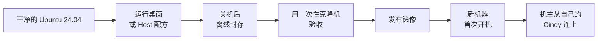

<p align="center">
  <a href="https://cindy.app"></a>
</p>

<p align="center">
  <a href="README.md">English</a> · <strong>简体中文</strong>
</p>

<p align="center">
  <a href="https://github.com/makecindy/cindy-cloud-images/actions/workflows/check.yml"></a>
  
  
</p>

<p align="center">
  <a href="https://github.com/makecindy/cindy">Cindy</a> &nbsp;·&nbsp; <a href="https://cindy.app">官网</a> &nbsp;·&nbsp; <a href="docs/cindy-readiness.md">交付验收清单</a> &nbsp;·&nbsp; <a href="docs/builder-maintenance.md">制镜机维护</a>
</p>

# Cindy Cloud Images

**开箱即用的 Cindy 操作系统环境。** 这里是 Cindy 云电脑背后的 Ubuntu 24.04 镜像配方。用它做出来的机器，开机时 [Cindy](https://github.com/makecindy/cindy) 已经装好并在运行，机主从自己的 Cindy 账号里就能直接给它派任务。

| 镜像 | 运行什么 | 在哪里定制 |
| --- | --- | --- |
| **桌面** | Cindy 加 XFCE 桌面，带认证的 X11 显示，默认浏览器是 Chrome，另有 Firefox | [桌面安装脚本和首次开机设置](desktop/install-desktop.sh) |
| **Host** | 以 systemd 用户服务运行的 Cindy Host，每台机器有独立的凭据库 | [Host 安装脚本](host/prepare-host-image.py)和[密钥环设置](host/host-keyring.sh) |

## 镜像里有什么

| | 桌面镜像 | Host 镜像 |
| --- | --- | --- |
| **开机自启** | XFCE 开机启动 Cindy | systemd 用户服务先完成注册，再启动 Cindy Host |
| **一台 Cindy 能操作的电脑** | 独立的 X11 会话，带 XTest 输入、剪贴板工具、AT-SPI 和用户 D-Bus | 终端和后台任务 |
| **浏览器** | Chrome Stable 处理网页链接，Firefox 可选 | 由具体任务按需安装 |
| **文件与开发** | Thunar、Mousepad、PDF 查看器、压缩包管理、Git、ripgrep、rsync、curl、jq | 随 Host 发行包提供 Node 运行时 |
| **语言与显示** | 十种界面语言，中日韩字体和 emoji 字体，1600 × 1000 或 1920 × 1080 | 随 Ubuntu 基础环境 |
| **Cindy 更新** | 首次开机装上最新正式版，之后空闲时自动安装更新 | 固定为镜像里的版本 |
| **外观** | Cindy Whisper 壁纸、深色窗口，底栏固定 Cindy、Chrome、文件和终端 | — |

每台机器都有自己的身份。封存镜像时会清除制镜机身份、SSH 主机密钥和 cloud-init 状态，镜像里还留着注册文件、密钥环状态或浏览器配置时拒绝封存。SSH 只接受机主设备的公钥，由机器上的 Cindy 维护。

## 从干净的 Ubuntu 到开箱即用



两套配方都以干净的 Ubuntu 镜像为起点，要求系统里有 `ubuntu` 用户和 systemd。使用可信的 Cindy Linux 发行包，它要支持云端注册，并与目标机器的架构和服务环境一致。发行包的 SHA-256 摘要取自已批准的发布记录。本仓库只包含构建说明和测试；各地区的镜像 ID、计费和一次性的机器注册由交付服务负责。

共用的包月制镜机、续费检查和各地区镜像发布，见[制镜机维护](docs/builder-maintenance.md)。

## 制作桌面镜像

以下命令在**干净的 Ubuntu 24.04 构建机**上运行。把 `DESKTOP_DEB` 设为安装包路径，`DEB_SHA256` 设为它已批准的摘要。制镜会修改 SSH 配置并安装系统包，请通过带外通道管理构建机。

```sh
sudo bash desktop/install-desktop.sh --prepare-image "$DEB_SHA256" "$DESKTOP_DEB"
```

安装脚本会准备 XFCE、凭据库、Ubuntu 桌面语言包（`en-US`、`zh-CN`、`zh-TW`、`ja-JP`、`ko-KR`、`de-DE`、`fr-FR`、`es-ES`、`pt-BR`、`pt-PT`）和 Cindy 的自启动项。它从 Google 的签名 APT 源安装 Google Chrome Stable，并设为网页链接的系统默认程序。Firefox 仍然可用，另外还有文本编辑器、PDF 查看器、压缩包管理和基础命令行工具。安装完成后关闭构建机，把系统盘挂载到另一台 Linux 机器上。

每台交付出去的机器上：

- **激活。** 交付引导程序调用 `/usr/local/lib/cindy-cloud-desktop/activate`，传入语言、分辨率和时区，例如 `en-US 1920x1080 America/Los_Angeles`，离线写入会话默认值和 `/etc/default/locale`。
- **无人值守更新。** 激活时还会打开 Cindy 的「空闲时安装更新」，用户已经自己选过的不改；镜像装有 `pkexec` 和一条 polkit 规则，桌面用户的更新安装时不弹密码框。
- **首次开机。** 每台机器先按镜像里 Cindy 的区域装好最新正式版，桌面会话再启动 Cindy；下载或任何一项校验失败时保留镜像里的版本。
- **会话。** 桌面会话使用该用户的 systemd 会话总线。

请在仓库检出目录里运行安装脚本，它要读取 [XFCE 默认配置和壁纸](desktop/appearance/README.md)。新建的桌面配置默认使用 Cindy Whisper 壁纸、深色窗口，底栏固定 Cindy、Chrome、文件和终端。用户可以在 XFCE 设置里自行调整外观。

## 制作 Host 镜像

在干净的基础镜像里安装 `dbus-user-session`、`gnome-keyring`、`libsecret-tools`、`openssl` 和 `util-linux`。关闭构建机，把系统盘挂载到另一台 Linux 机器上。把 `IMAGE_ROOT` 设为挂载点，`HOST_RELEASE` 设为解压后的发行包目录，`INVENTORY_SHA256` 设为其中 `SHA256SUMS.json` 的摘要。版本（`cn` 或 `global`）和架构（`x64` 或 `arm64`）要与发行包一致。

```sh
sudo python3 host/prepare-host-image.py "$HOST_RELEASE" \
  --root "$IMAGE_ROOT" --inventory-sha256 "$INVENTORY_SHA256" \
  --edition global --arch x64
```

安装脚本先核对清单和其中列出的每个文件，再安装发行包和服务。交付引导程序为机器准备好注册材料后，启用 `cindy-cloud-host.service`。

## 封存与验证

两种镜像都要在另一台机器上对**已关机的镜像**做封存。这一步单独使用一块新的构建盘。

```sh
sudo python3 common/seal-offline-image.py --offline-root "$IMAGE_ROOT"
```

两种镜像都把 sshd 限制为只认 `~ubuntu/.ssh/cindy-owner-authorized-keys`，这个文件由机器上的 Cindy 为机主的设备维护；镜像还装有一个开机闸门（`common/ssh_access_gate.py`），在 Cindy 重新核对设备名单之前，先扣住 Cindy 写入的公钥列表。封存时发现已知的 Cindy 注册文件、密钥环状态、浏览器配置或 Snap 凭据会拒绝继续。它会清除制镜机身份、SSH 主机密钥和 cloud-init 状态，让每台新机器都以自己的身份启动。打快照前先卸载封存好的卷。用 [Cindy 交付验收清单](docs/cindy-readiness.md)验收一次性克隆机，并记录发布凭据。

## 仓库结构

```text
desktop/   桌面镜像：安装脚本、首次开机的激活与更新、XFCE 外观
host/      Host 镜像：发行包安装脚本和每台机器独立的密钥环设置
common/    两种镜像共用：离线封存和 SSH 访问闸门
docs/      交付验收清单和制镜机维护
```

每个目录的测试和它覆盖的代码放在一起（`test_*.py`）。

## 本地检查

在开发机上用 Bash、Make 和 Python 3.9+ 运行 `make test`。测试只使用临时目录，不需要任何云端凭据。GitHub Actions 在 Ubuntu 上运行同样的检查。完整安装和机器启动属于单独的镜像验收步骤。

## 文档

- [Cindy 交付验收清单](docs/cindy-readiness.md)：每种镜像准备了哪些能力、权限由谁授予，以及首次开机的验收项。
- [制镜机维护](docs/builder-maintenance.md)：共用的制镜机、制镜身份、续费检查和各地区发布。
- [桌面外观](desktop/appearance/README.md)（英文）：壁纸、主题和底栏的默认配置。

## 发布须知

凭据、租户配置、私有镜像标识、用户机器上的数据、二进制安装包和磁盘镜像，都保存在各自的发布或部署系统里。公开仓库前，先选定源码许可证，并审阅计划发布的各项制品的分发条款。
